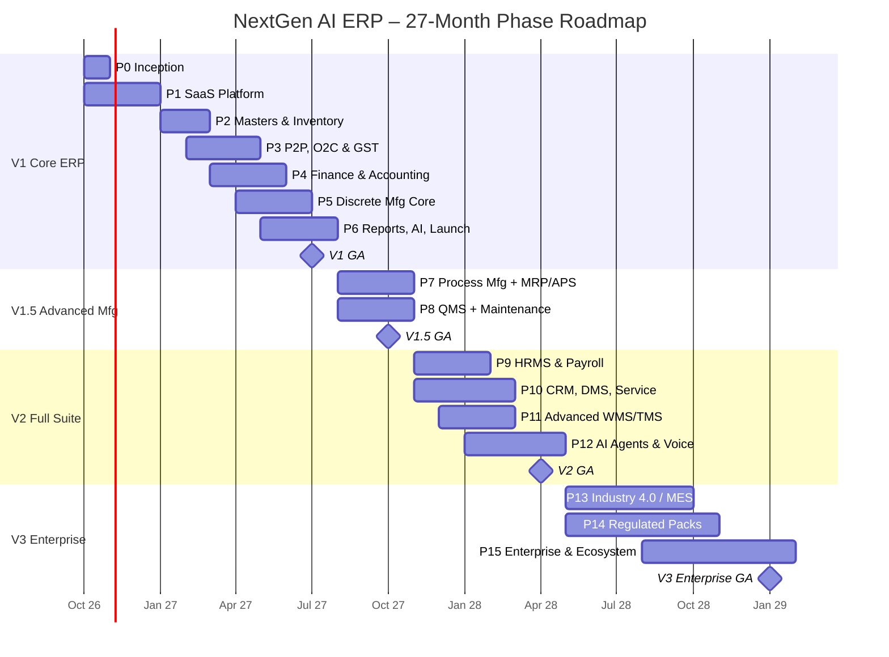

# NextGen AI ERP — Phase-wise Master Plan (Advanced, Industry-Driven)

| | |
|---|---|
| **Document** | Phase-wise delivery plan v1.0. Companion to [PROJECT_PLAN.md](PROJECT_PLAN.md) |
| **Date** | 5 October 2026 |
| **Planning horizon** | 27 months (V1 GA at Month 9, Enterprise GA at Month 27) |
| **Target industries** | Process: Pharma, Chemical, Paint, Lubricants, Cosmetics, FMCG, Food Processing · Discrete: Automobile/Auto-components, Electronics, Plastic, Textile & Apparel, Engineering/Fabrication, Furniture, Packaging, Machinery |
| **Status** | Draft for approval |

---

## Contents
1. [Phase Map at a Glance](#1-phase-map-at-a-glance)
2. [Industry Requirements Matrix](#2-industry-requirements-matrix)
3. [Phase Details (0–15)](#3-phase-details)
4. [Industry Pack Delivery Schedule](#4-industry-pack-delivery-schedule)
5. [AI Capabilities by Phase](#5-ai-capabilities-by-phase)
6. [Compliance & Certification Roadmap](#6-compliance--certification-roadmap)
7. [Team Scaling by Phase](#7-team-scaling-by-phase)
8. [Phase Governance](#8-phase-governance)
9. [Scale Targets](#9-scale-targets)

---

## 1. Phase Map at a Glance

| Phase | Name | Months | Release |
|---|---|---|---|
| **0** | Inception, Discovery & Foundations | M1 | — |
| **1** | SaaS Platform Core | M1–M3 | V1 |
| **2** | Enterprise Masters & Inventory | M3–M4 | V1 |
| **3** | Procure-to-Pay, Order-to-Cash & GST | M4–M6 | V1 |
| **4** | Finance & Accounting | M5–M7 | V1 |
| **5** | Discrete Manufacturing Core | M6–M8 | V1 |
| **6** | Reports, AI Copilot v1 & V1 Launch | M7–M9 | **V1 GA (M9)** |
| **7** | Process Manufacturing & Advanced Planning (MRP II / APS) | M10–M12 | V1.5 |
| **8** | Quality Management (QMS) & Maintenance (EAM/TPM) | M10–M12 | **V1.5 GA (M12)** |
| **9** | HRMS & Payroll | M13–M15 | V2 |
| **10** | CRM, Distribution (DMS) & After-Sales Service | M13–M16 | V2 |
| **11** | Advanced Warehouse & Logistics (WMS/TMS) | M14–M16 | V2 |
| **12** | AI Agents, Voice & Predictive Intelligence | M15–M18 | **V2 GA (M18)** |
| **13** | Industry 4.0: IIoT, MES & Digital Twin | M19–M23 | V3 |
| **14** | Regulated Industry Packs (GMP, IATF, FSSAI validation) | M19–M24 | V3 |
| **15** | Enterprise Scale & Ecosystem (Consolidation, White-label, Marketplace, Native Mobile) | M22–M27 | **V3 Enterprise GA (M27)** |

**Guiding rule:** each phase ships to production behind feature flags. Pilot customers use features as they land. "GA" means the release is commercially sold to everyone.

---

## 2. Industry Requirements Matrix

These are the industry-specific capabilities the product must cover. Each one is mapped to the phase that delivers it (shown in brackets).

### 2.1 Process Manufacturing

| Industry | Critical requirements | Regulations / standards |
|---|---|---|
| **Pharma** (formulations, API, bulk drugs) | Master Formula Record (MFR) with versioning & approval [P7]; electronic Batch Manufacturing/Packing Records (eBMR/eBPR) [P14]; dispensing with weighing-scale integration [P7]; potency/assay-based quantity adjustment [P7]; retest & expiry dates [P2]; quarantine → QC → release status for every lot [P8]; line clearance [P14]; stability studies [P14]; deviation, change control, CAPA [P8]; vendor qualification (approved manufacturer list) [P8]; QR/barcode on API labels & track-and-trace for top brands [P14]; export serialisation (GS1, iVEDA) [P14]; e-signatures & audit trail (Part 11) [P14]; computer system validation (IQ/OQ/PQ) docs [P14] | Revised Schedule M (GMP), CDSCO, Drugs & Cosmetics Act, 21 CFR Part 11, EU GMP Annex 11, WHO-GMP, GAMP 5, DPCO pricing |
| **Chemical** | Formula/recipe with co-products & by-products [P7]; concentration/assay-based stock [P7]; tank & silo inventory (dip/level readings) [P11]; density & temperature-corrected UoM conversion [P2]; reaction yield & loss tracking [P7]; SDS/MSDS management & GHS hazard labels [P7]; hazardous goods storage compatibility rules [P11]; hazardous waste records [P8]; licence tracking (PESO, Pollution Control Board) [P8] | Hazardous Waste Rules, MSIHC Rules, PESO, GHS, REACH (exports), BIS |
| **Paint & Coatings** | Base + tinter formula by shade [P7]; shade cards & colour-matching versions [P7]; pack-size variants (1L/4L/10L/20L) from one bulk batch [P7]; kg ↔ litre via density [P2]; tinting-machine integration for dealers [P10]; dealer/retailer schemes & loyalty [P10]; VOC content per product [P7]; batch shade-deviation QC [P8] | BIS, Legal Metrology (MRP labelling), VOC limits |
| **Lubricants** | Blending of base oils + additives [P7]; tank-farm management [P11]; returnable packaging (drums/barrels/IBCs) with deposit tracking [P11]; temperature-corrected density [P2]; OEM approvals per product [P2]; channel/dealer schemes [P10] | BIS, API/ACEA specs, Legal Metrology |
| **Cosmetics** | Formula versioning with ingredient INCI names [P7]; batch coding & expiry [P2]; allergen/ingredient declarations on labels [P7]; claims substantiation documents [P15 DMS]; distributor & e-commerce channels [P10] | CDSCO Cosmetics Rules 2020, BIS, Legal Metrology |
| **FMCG** | High-volume batch production & packing lines [P7]; Distributor Management System (secondary sales, claims, schemes, beat plans, van sales) [P10]; MRP/price change management [P3]; FEFO dispatch [P11]; trade promotions & claim settlement [P10]; modern trade/e-commerce integration (EDI/APIs) [P15] | Legal Metrology, FSSAI (food FMCG) |
| **Food Processing** | Recipe with nutrition values [P7]; lot traceability one-up/one-down with mock recall in < 2 hours [P7]; FEFO & shelf-life rules (minimum remaining shelf life per customer) [P11]; allergen management & segregation [P8]; HACCP plans & CCP monitoring [P8]; catch-weight (variable-weight items) [P2]; cold-chain temperature logging [P13]; FSSAI licence tracking [P8]; by-products & wastage [P7] | FSSAI, FSMA (exports), HACCP, ISO 22000/FSSC 22000, BRCGS |

### 2.2 Discrete Manufacturing

| Industry | Critical requirements | Regulations / standards |
|---|---|---|
| **Automobile / Auto-components** | Customer schedules & releases (monthly/weekly/daily) [P10]; EDI (DELFOR/DESADV) and OEM portal integration [P15]; ASN with labels [P11]; JIT/JIS & Kanban [P7]; part-level traceability (heat/lot → part → shipment) [P5]; APQP, PPAP (18 elements), PFMEA, control plans [P14]; SPC (X-bar R, Cp/Cpk) [P8]; MSA/gauge R&R & calibration [P8]; tool & die life (shot/stroke count) [P8]; returnable packaging/bins at customer [P11]; warranty & field-failure analysis (8D) [P8]; sub-contract/job work with ITC-04 [P3] | IATF 16949, ISO 9001, AIAG manuals, VDA, ITC-04 (GST job work) |
| **Electronics** | Multi-level BOM with alternates & approved vendor list (AVL/AML) [P5]; component lifecycle & obsolescence (EOL) alerts [P12]; MSL (moisture-sensitive device) floor-life tracking [P11]; reel/spool inventory with partial quantities [P11]; SMT line programs & feeder setups [P13]; serial number traceability & genealogy [P5]; firmware/software version tracking per serial [P5]; ECO/ECN with effectivity dates [P7]; RMA & repair [P10]; e-waste EPR [P8] | RoHS, REACH, BIS CRS, IPC standards, E-Waste Rules (EPR) |
| **Plastic (Injection/Blow/Extrusion)** | Mould master (cavities, cycle time, shot count, maintenance trigger) [P8]; machine-mould-material compatibility [P5]; regrind/recycled % in BOM [P7]; masterbatch & colour formulas [P7]; runner/scrap recovery [P5]; weight-based production reporting [P5]; machine-wise OEE [P13]; EPR plastic-waste compliance [P8] | Plastic Waste Management Rules (EPR), BIS |
| **Textile & Apparel** | Spinning/weaving/knitting/processing routes [P7]; job work (sizing, dyeing, printing, stitching) with ITC-04 [P3]; lot, shade, roll & piece management [P2]; multi-UoM (kg/metre/pieces/cones) [P2]; count, GSM, width attributes [P2]; size-colour-style matrix (garments) [P2]; cut plans & marker efficiency [P7]; buyer-specific packing lists & labels [P10]; compliance audits for export buyers [P14] | GST job-work rules, OEKO-TEX, GOTS, buyer codes of conduct |
| **Engineering / Fabrication** | Make-to-order & project-based manufacturing [P5]; drawing & revision management [P7]; heat-number/mill-certificate traceability [P5]; weight-based estimation & costing [P5]; sheet/plate nesting results import [P13]; sub-contracting (machining, galvanizing, painting) [P3]; inspection & test plans (ITP) with third-party inspection [P8]; milestone billing [P4] | ISO 9001, ASME/IS codes, ITC-04 |
| **Furniture** | Product configurator (configure-to-order: size, finish, fabric) [P10]; cut lists & panel optimisation [P7]; hardware kits [P5]; made-to-order + stock items [P5]; delivery & installation scheduling [P10]; showroom/retail POS [P15] | BIS, Legal Metrology |
| **Packaging (Corrugated/Flexible/Mono-carton)** | Estimation & costing engine (ply, GSM, flute, size, printing colours, lamination) [P10]; die/plate/cylinder master [P8]; reel inventory by weight & deckle [P2]; job cards per customer design [P5]; artwork approval workflow [P10]; repeat-order quick costing [P10]; wastage % by process [P5]; EPR [P8] | EPR (plastic packaging), FSSAI (food-contact packaging) |
| **Machinery (Engineer-to-Order)** | Project-based manufacturing with WBS [P15]; long-lead procurement planning [P7]; project costing (budget vs actual) [P15]; milestone/advance billing [P4]; installation & commissioning [P10]; warranty & AMC contracts [P10]; spare-parts catalogue & service orders [P10]; serial-wise as-built BOM [P5] | ISO 9001, CE (exports) |

### 2.3 Cross-industry advanced requirements (every customer)

| Capability | Phase |
|---|---|
| Multi-company, multi-branch, multi-plant, multi-warehouse, multi-currency | P1–P4 |
| GST complete (e-Invoice, e-Way Bill, RCM, ITC-04, GSTR-1/3B/2B reconciliation) | P3–P4 |
| Sub-contracting / job work (outward & inward) with material reconciliation | P3, P5 |
| Landed cost (freight, customs duty, insurance, clearing) apportionment | P3 |
| Imports & exports (BoE, shipping bill, LUT, EPCG/Advance Authorisation licences, foreign-currency gain/loss) | P3–P4 |
| Standard, actual, batch & job costing with variance analysis | P5, P7 |
| MRP II + finite-capacity scheduling (APS) | P7 |
| Quality (IQC/IPQC/FQC, SPC, NCR, CAPA, 8D) | P5, P8 |
| Maintenance (breakdown, preventive, predictive, calibration, spares) | P8, P13 |
| Tally migration & co-existence (two-way sync during transition) | P2, P4 |
| Multilingual UI (English, Hindi + 4 regional languages) | P6, P12 |
| Mobile-first shop-floor & warehouse apps (offline-capable) | P6 (PWA), P15 (native) |

---

## 3. Phase Details

Every phase lists: **Goal → Scope (features) → Industry-specific features → AI in this phase → Integrations → Deliverables → Exit criteria.**

---

### Phase 0 — Inception, Discovery & Foundations (M1, 4 weeks)

**Goal:** remove ambiguity, set up the engineering machinery, and lock decisions.

**Scope**
- Business discovery: interview 8–10 MSMEs (at least 4 discrete, 4 process). Map the AS-IS processes and the top 20 pain points.
- Finalise personas (Owner/MD, Plant Head, Store Keeper, Purchase Exec, Sales Exec, Accountant, QC Inspector, Production Supervisor, HR Exec, CA/Auditor).
- Freeze V1 scope; sign off decisions D1–D9 ([PROJECT_PLAN.md §17](PROJECT_PLAN.md)).
- Competitive teardown: Tally Prime, Zoho Books/Inventory, Odoo, ERPNext, SAP Business One, Marg, Busy. Hands-on, flow by flow.
- Architecture Decision Records (ADR-01…09), module-spec template, Definition of Done.
- Monorepo, Docker Compose, CI/CD to dev/staging, Terraform baseline (AWS ap-south-1), observability baseline.
- Design system foundations: tokens, typography, colours, grid, light/dark, core components; Figma library + Storybook.
- GSP partner and payment gateway selection; sandbox credentials requested.

**Deliverables:** Vol 1 v1.0 (vision, personas, pricing draft), ADRs, Platform & IAM module spec, design-system v0.1, running skeleton on staging.
**Exit criteria:** staging auto-deploys from `main`; the scope document is signed; at least 2 pilot customers are signed as design partners.

---

### Phase 1 — SaaS Platform Core (M1–M3, 10 weeks)

**Goal:** a secure, multi-tenant platform that every module plugs into.

**Scope**

| Area | Features |
|---|---|
| **Tenancy** | Self-serve signup → tenant provisioning (< 60 s) with industry template selection; tenant → company → branch → plant hierarchy; PostgreSQL RLS; per-tenant limits & usage counters; tenant suspension/archival |
| **Identity & Access** | Email/mobile login, OTP, TOTP MFA, password policies, session/device management, IP allow-listing, login anomaly alerts; RBAC with `module.resource.action` permissions; data scopes (company/branch/plant/warehouse); field-level security (mask cost/salary/bank); role templates per industry; delegation (out-of-office approver) |
| **Subscription & Billing** | Plans, add-ons, feature flags, trials, Razorpay subscriptions (UPI autopay, cards, NACH), coupons, GST-compliant SaaS invoices, dunning, upgrade/downgrade with proration, usage metering (users, companies, storage, AI credits, API calls) |
| **Document Framework** | Numbering series (per company/branch/FY/doc-type), configurable status machine, multi-level approval matrix (amount slabs, conditions, parallel/sequential), amendments & revisions, linked documents with quantity tracking, attachments, comments & @mentions, activity timeline, print/email/WhatsApp share |
| **Posting Engine (framework)** | Rule-based stock & GL posting, reversal on cancel, posting preview ("what will this document post?") |
| **Customisation** | Custom fields (all types incl. lookup & formula), custom print formats (HTML/Handlebars designer), custom list views & saved filters, form layout tweaks, server-side validation rules (no-code) |
| **Notifications** | Event → template → channel (in-app, email, WhatsApp Business API, SMS); user preferences; digests; escalation rules |
| **Audit & Compliance** | Immutable audit trail with field diffs (meets the Companies Act audit-trail rule); login history; data export per tenant; DPDP consent & data-principal request workflows |
| **Integration** | REST API v1 with OpenAPI docs, API keys & OAuth2 client credentials, webhooks (signed, retried), rate limits |
| **UX shell** | Navigation, global search, command palette (Ctrl+K), keyboard shortcuts, notifications centre, breadcrumbs, recent items, favourites, light/dark theme, responsive layout, i18n framework |
| **Super Admin console** | Tenant management, plan management, impersonation (audited, with consent), system health, feature-flag rollout, announcements |

**Industry-specific:** industry templates at signup pre-load the chart of accounts, UoMs, item groups, document workflows and roles for each of the 15 industries.
**AI:** AI Gateway skeleton (provider routing, metering, PII redaction); help-docs RAG for "How do I…?" questions.
**Exit criteria:** pentest of auth & tenancy shows no high findings; an automated cross-tenant isolation test suite is green; a demo document type runs end-to-end (draft → multi-level approval → print → audit).

---

### Phase 2 — Enterprise Masters & Inventory (M3–M4, 8 weeks)

**Goal:** a complete master-data foundation and an accurate, auditable stock ledger.

**Scope**

| Area | Features |
|---|---|
| **Organisation masters** | Company (multi-GSTIN), Branch, Plant, Factory, Department, Warehouse, Cost Center (hierarchical), Profit Center, Financial Year, Holiday calendars |
| **Item Master (full)** | General, inventory, purchase, sales, manufacturing, accounting & GST tabs; item types (RM, PM, SFG, FG, consumable, spare, service, asset, scrap, by-product); variants (size-colour-style matrix); alternate UoMs with conversion (fixed, density-based, catch-weight); batch & serial rules; shelf life, retest period, minimum remaining shelf life; barcodes (EAN/GS1/QR/internal); images & attachments; price history; vendor & customer item mapping (part numbers); reorder level/qty, safety stock, lead time; ABC/XYZ/FSN class; HSN with GST rates (effective-dated); technical attributes (grade, GSM, count, density, potency); quality parameters link; storage conditions; hazardous class |
| **Business partners** | Customer & Vendor (multi-address, multi-GSTIN, contacts, bank details with penny-drop verification, credit limit & days, payment terms, TDS/TCS profile, MSME (Udyam) status for 45-day payment rule, price lists, approved/blocked status, documents & KYC) |
| **Other masters** | UoM, Tax (GST, cess, TDS/TCS sections), Currency & exchange rates (auto-feed), Bank, Payment terms (with milestones), Price lists (customer/group/quantity-break/validity), Transporters, Brokers/Agents with commission |
| **Inventory** | Immutable stock ledger; valuation FIFO / Weighted Average / Moving Average / Standard (per item group); multiple warehouses & locations; stock transfers (inter-warehouse, inter-branch with GST delivery challan/e-way bill); stock adjustments with reasons & approval; physical stock count & cycle counting (mobile); batch & serial tracking with expiry; FEFO/FIFO picking suggestions; quarantine/QC-hold/rejected stock status; reserved vs available stock; reorder alerts; material requests; returnable/non-returnable gate passes; barcode/QR label printing (Zebra/TSC templates) |
| **Data migration** | Excel templates with validation preview; Tally XML/ODBC import (masters, opening balances, opening stock, outstanding bills); bulk update |

**Industry-specific**
- **Pharma/Food/Cosmetics:** retest & expiry, minimum shelf-life, quarantine status.
- **Chemical/Lubricants/Paint:** density & temperature-corrected conversions, concentration attribute.
- **Food:** catch-weight items.
- **Textile:** roll/piece/shade/lot, multi-UoM (kg/metre/cones), GSM/count attributes.
- **Apparel/Furniture:** size-colour-style matrix variants.
- **Packaging/Paper:** reel inventory by weight & deckle size.
- **Electronics:** reel/partial-quantity tracking, MSL attribute.

**AI:** duplicate detection (vendors/items with fuzzy matching); HSN code suggestion from item description; Copilot answers on stock queries.
**Exit criteria:** a pilot tenant's opening data (≥ 5,000 items, ≥ 1,000 parties) is imported from Tally/Excel in under 1 day; stock valuation reconciles with the source system.

---

### Phase 3 — Procure-to-Pay, Order-to-Cash & GST (M4–M6, 12 weeks)

**Goal:** complete buying and selling cycles with fully automated GST compliance.

**Scope: Procure-to-Pay**

| Area | Features |
|---|---|
| Requisition | Purchase requisition (manual, from MRP, from reorder), budget check, approvals |
| Sourcing | RFQ to multiple vendors (email/WhatsApp/vendor link), vendor quotation capture, comparative statement (price, lead time, terms, past quality score), negotiation history, award |
| Ordering | PO (standard, blanket/rate contract, scheduled delivery, service PO, import PO, sub-contract/job-work PO), amendments with revision, advance payments, PO tolerance rules |
| Receiving | Gate entry → GRN (against PO/ASN, with barcode scan), weighbridge integration, quantity/rate tolerance, QC trigger (quarantine → accept/reject/partial), short/excess/damaged handling, rejection → return challan, debit note |
| Invoicing | Purchase invoice with 2-way/3-way match (PO-GRN-Invoice), GST ITC eligibility, RCM, TDS deduction, landed cost voucher (freight, duty, insurance, CHA) apportioned by value/qty/weight |
| Imports | Import PO, proforma, Bill of Entry, customs duty (BCD, SWS, IGST), foreign-currency invoices, forex gain/loss, EPCG/Advance Authorisation licence utilisation tracking |
| Job work / Sub-contracting | Outward challan with material (ITC-04), job-worker stock tracking, inward receipt with consumption reconciliation, process loss, job-work charges invoice, 1-year/3-year return deadline alerts |
| Vendor management | Vendor rating (quality, delivery, price), approved vendor list per item, MSME payment-due tracking (45-day rule, Sec 43B(h)) |

**Scope: Order-to-Cash**

| Area | Features |
|---|---|
| Pre-sales | Quotation (versions, validity, margin preview, approval if discount > threshold), proforma invoice |
| Orders | Sales order (standard, blanket, scheduled, export, job-work inward, consignment), credit-limit & overdue check with approval override, ATP (available-to-promise), reservation, back-orders |
| Fulfilment | Pick list, packing list (packages, weights, dimensions), delivery note/dispatch, transporter & vehicle details, LR number, proof of delivery |
| Billing | Tax invoice, bill of supply, export invoice (with/without LUT), SEZ supplies, deemed exports, advance receipts with GST, milestone/progress billing, recurring invoices |
| Returns | Sales return with QC (restock/scrap/rework), credit note, debit note, rate-difference notes |
| Pricing | Price lists, schemes (quantity, slab, free goods), discounts with approval, MRP & Legal Metrology fields, price change management |

**Scope: GST & e-Compliance**
- GST engine: place of supply, intra/inter-state, UTGST, cess, RCM, exempt/nil/non-GST, composition, SEZ, exports.
- **e-Invoice:** IRN generation via GSP, signed QR on print, cancellation within 24 h, bulk generation, auto-retry.
- **e-Way Bill:** from invoice/delivery note/stock transfer/job-work challan, Part-B vehicle update, extension, cancellation, consolidated EWB.
- GSTIN validation & party status checks; HSN summary; ITC-04 return data.

**Industry-specific**
- **Auto/Engineering/Textile/Packaging:** job-work & sub-contracting (ITC-04) depth.
- **Pharma:** sales only to licensed parties (drug licence validation & expiry block); near-expiry sales rules.
- **FMCG/Paint/Lubricants:** scheme & free-goods engine, MRP on invoice.
- **Machinery/Engineering:** milestone & advance billing.
- **Chemical:** dangerous-goods declarations on dispatch.
- **Exporters (all):** shipping bill, LUT, export incentives tracking.

**AI:** OCR purchase invoice → draft PI with vendor/item matching (≥ 90% field accuracy target); vendor recommendation in comparative statement; Copilot "create PO for 500 kg resin from the cheapest approved vendor" → draft.
**Exit criteria:** IRN and e-way bill generated in the GSP sandbox for all scenario types (B2B, export, SEZ, RCM, credit note); P2P and O2C E2E suites green; a CA validates GST computation on 200 test scenarios.

---

### Phase 4 — Finance & Accounting (M5–M7, 12 weeks, overlaps P3)

**Goal:** a complete, auditor-ready accounting suite where every operational transaction posts automatically.

**Scope**

| Area | Features |
|---|---|
| **General Ledger** | Multi-level CoA (Schedule III-ready templates per industry), journals (manual, recurring, reversing), posting rules from all modules, period locking, year-end closing & carry-forward, multi-GAAP-ready dimension tagging (cost center, profit center, project, plant) |
| **Accounts Receivable** | Customer ledger, invoice-wise outstanding, ageing (configurable buckets), receipts with allocation (FIFO/manual/on-account), advances, credit notes, interest on overdue, dunning reminders (email/WhatsApp), customer statements, bad-debt write-off |
| **Accounts Payable** | Vendor ledger, bill-wise payables, payment proposals by due date/priority/MSME status, payment batches, bank file export (H2H formats for SBI, HDFC, ICICI, Axis), advances, debit notes |
| **Cash & Bank** | Cash/bank/contra vouchers, cheque management (PDC register, bounce handling), bank statement import (CSV/MT940/PDF via OCR), auto-reconciliation with matching rules, payment-gateway settlement reconciliation |
| **Tax** | TDS/TCS (all sections, thresholds, lower-deduction certificates), 26Q/27Q data, Form 16A; GSTR-1, GSTR-3B preparation; GSTR-2B reconciliation with ITC mismatch actions; GST payment & set-off computation; RCM liability |
| **Fixed Assets** | Asset register, capitalisation from PI/CWIP, depreciation (SLM/WDV, Companies Act & Income-Tax Act books), transfers, disposal, revaluation, asset tagging (QR) |
| **Budgeting** | Budgets by account/cost center/project, monthly phasing, budget-vs-actual, budget control on PR/PO (warn/block) |
| **Costing** | Cost centers, overhead allocation rules, product costing hooks for manufacturing |
| **Multi-currency** | Foreign-currency transactions, revaluation, realised/unrealised gain/loss |
| **Financial statements** | Trial balance, P&L, Balance Sheet (Schedule III), Cash Flow (indirect), ratio analysis, comparative periods, drill-down to source document |
| **Controls** | Maker-checker on vouchers, audit trail (Companies Act edit log), auditor read-only role, period close checklist |

**Industry-specific:** milestone billing & project ledgers (Machinery/Engineering); dealer incentives & scheme accruals (FMCG/Paint/Lubricants); EPCG/Advance Licence export-obligation tracking (exporters).
**AI:** auto bank reconciliation suggestions; anomaly detection on journals (unusual amount/account/time); Copilot "show receivables overdue > 60 days for the Hyderabad branch"; cash-flow forecast (basic).
**Exit criteria:** a full-year golden dataset produces TB/P&L/BS that match the CA-prepared accounts; GSTR-1/3B outputs match the manual computation; bank recon auto-matches ≥ 85% of lines.

---

### Phase 5 — Discrete Manufacturing Core (M6–M8, 12 weeks)

**Goal:** plan-to-produce for discrete manufacturers with accurate costing and traceability.

**Scope**

| Area | Features |
|---|---|
| **Engineering data** | Multi-level BOM (phantom, alternate components, by-product, scrap %), BOM versions with effectivity dates & approval, routing with operations, work centers (capacity, cost rates), machines, tools/dies/moulds master, drawing attachments |
| **Production orders** | Work orders (make-to-stock, make-to-order linked to SO, rework orders), order splitting/merging, material reservation, release with availability check |
| **Shop floor** | Material issue (manual, backflush at operation/order completion), job cards per operation (start/stop/pause, operator, machine, setup time, run time), production entry (good/rejected/rework), scrap & by-product receipt, WIP tracking, sub-contract operations within routing (job work) |
| **Traceability** | Lot/serial genealogy (RM lot → WO → FG serial → customer), heat-number traceability, as-built BOM per serial, firmware/software version per serial |
| **Costing** | Standard cost roll-up, actual cost per work order (material + labour + machine + overhead + sub-contract), variance analysis (material price/usage, labour efficiency, overhead), WIP valuation |
| **Basic quality** | Incoming QC (on GRN), in-process QC at operation, final QC; inspection plans with parameters & sampling (AQL); accept/reject/rework decisions |
| **Shop-floor UX** | Tablet-optimised screens, barcode-driven job cards, offline-capable PWA, large-button mode |

**Industry-specific**
- **Auto-components:** part traceability, heat number, PPAP-ready inspection data.
- **Electronics:** alternates/AVL, serial genealogy, firmware tracking.
- **Plastic:** mould-machine linkage, weight-based reporting, runner/regrind recovery.
- **Engineering/Fabrication:** MTO with drawings, weight-based costing.
- **Furniture:** hardware kits, MTO.
- **Packaging:** job cards per design, process wastage.
- **Machinery:** serial-wise as-built BOM.

**AI:** Copilot "show today's production vs plan for Line 2"; "create production order for 5,000 units of part X" → draft with material availability check; scrap-trend insights.
**Exit criteria:** a pilot discrete manufacturer runs production for 4 weeks in parallel with the existing system; costing variance < 2% against the manual costing sheet.

---

### Phase 6 — Reports, AI Copilot v1 & V1 Launch (M7–M9, 12 weeks, overlaps P5)

**Goal:** make the product decision-ready, AI-powered and launch-hardened.

**Scope**

| Area | Features |
|---|---|
| **Standard reports (60+)** | Sales (register, by customer/item/region, margin), Purchase (register, pending POs, vendor performance), Inventory (stock summary, ledger, ageing, valuation, slow/non-moving, batch expiry), Production (plan vs actual, WO status, scrap, OEE-basic), Finance (all statutory statements, ageing, cash flow), GST (GSTR-1/3B/2B, HSN summary, ITC-04) |
| **Dashboards** | Role-based: CEO/Owner, Plant Head, Sales, Purchase, Stores, Production, Finance, QA; drill-down; configurable widgets; TV mode for shop floor |
| **Report builder v1** | Pick fields/filters/grouping, save & share, schedule email/WhatsApp delivery, export Excel/PDF |
| **AI Copilot v1** | Chat panel on every screen; natural-language data Q&A with charts; navigation ("open PO 45"); document drafting (PO, SO, invoice, WO) with a confirmation card; explanations ("why is this invoice blocked?"); English + Hindi |
| **Onboarding** | Guided setup wizard per industry, sample data mode, in-app tours, help centre, video library |
| **Hardening** | Performance (p95 < 300 ms; reports async), load test (500 concurrent users/tenant), third-party pentest, DR drill, accessibility (WCAG 2.1 AA core flows) |
| **GTM readiness** | Pricing pages, trial flow, partner/implementer onboarding kit, support desk, status page, SLA |

**Exit criteria (V1 GA):** at least 3 pilot customers live for ≥ 4 weeks; P1/P2 bug count = 0/≤ 5; NPS from pilots ≥ 30; all compliance scenarios certified in the GSP production environment.

---

### Phase 7 — Process Manufacturing & Advanced Planning (M10–M12, 12 weeks)

**Goal:** serve process industries deeply and give every manufacturer real planning.

**Scope: Process Manufacturing**

| Area | Features |
|---|---|
| **Formula / Recipe** | Master formula with versions, approval & effectivity; scalable batch sizes; ingredient quantities by %, by potency/assay, or fixed; co-products & by-products with cost apportionment; packaging recipes separate from bulk; INCI/ingredient declarations; nutrition values; SDS link; VOC values |
| **Batch production** | Batch orders, dispensing (weighing-scale integration, tolerance check, label print), stage-wise processing with in-process parameters, yield calculation (theoretical vs actual) & loss tracking, rework/re-processing, blending of batches, packing of bulk into pack sizes |
| **Potency & concentration** | Auto quantity adjustment by assay of the lot issued, active-ingredient based inventory |
| **Shade & tinting (Paint)** | Shade master, base + tinter formulas, shade-correction batches |
| **Cleaning** | CIP/cleaning logs, equipment status (clean/dirty/in-use), cleaning validation hooks |

**Scope: Advanced Planning**

| Area | Features |
|---|---|
| **Demand planning** | Sales forecast (statistical + AI), customer schedules, forecast consumption |
| **MRP II** | Multi-level net requirements with lead-time offsetting, lot-sizing rules (L4L, fixed, EOQ, min/max, period), safety stock, planned orders → PR/WO/job-work, pegging, exception messages (expedite/defer/cancel) |
| **Capacity planning** | Rough-cut (RCCP) and capacity requirements planning (CRP), work-center load charts |
| **APS (finite scheduling)** | Drag-and-drop Gantt scheduler, constraint-based (machine, tool/mould, operator skill, material), sequence-dependent setups (colour/shade sequencing for paint, plastic, textile), what-if scenarios |
| **Lean** | Kanban (e-Kanban cards), JIT/JIS call-offs, supermarket replenishment |
| **Engineering change** | ECR → ECN/ECO workflow with impact analysis (open WOs, stock, POs), effectivity |
| **Drawing & revision management** | Drawing register, revision control, release workflow |

**Industry-specific:** Pharma (MFR, dispensing, potency); Chemical (co-products, yield, reactions); Paint (shade/tinting, pack-size explosion); Lubricants (blending); Food (recipes with nutrition, lot trace one-up/one-down); Cosmetics (INCI formula); Textile (cut plans, marker efficiency, colour sequencing); Plastic (regrind %, masterbatch); Furniture (cut lists, panel optimisation).
**AI:** demand forecasting (seasonality, festivals, promotions); AI-suggested production schedule; yield-loss root-cause insights.
**Exit criteria:** 2 process-manufacturing pilots live (target: 1 pharma/chemical + 1 food/paint); MRP run for 10,000 items in < 2 min; mock recall trace completed in < 5 min.

---

### Phase 8 — Quality Management & Maintenance (M10–M12, 12 weeks, parallel to P7)

**Goal:** a full QMS and plant maintenance suite for ISO/IATF/GMP-oriented plants.

**Scope: QMS**

| Area | Features |
|---|---|
| Inspection | Specifications per item/vendor/customer, sampling plans (AQL, skip-lot), IQC/IPQC/FQC/PDI, lab tests & certificates of analysis (CoA) generation, COA from vendors (OCR), retain samples |
| Lot status | Quarantine → under test → released/rejected/conditional release, QA release with e-signature |
| Non-conformance | NCR, MRB disposition (use-as-is, rework, scrap, return), cost of poor quality |
| CAPA & problem solving | CAPA with root-cause tools (5-Why, Fishbone), 8D reports, effectiveness checks |
| SPC | Control charts (X-bar R, X-bar S, I-MR, p, np, c, u), Cp/Cpk/Pp/Ppk, Western Electric rules alerts |
| Supplier quality | Supplier scorecards, audits, SCAR, approved manufacturer list |
| Customer quality | Complaints, field failures, warranty analysis, 8D to customer |
| Change & deviation | Change control, deviation management with impact & risk assessment |
| Calibration & MSA | Gauge master, calibration schedules & certificates, gauge R&R studies |
| Audits & documents | Internal audit plans, findings, SOP management with versioning & training acknowledgement |
| HSE | Incident reporting, hazardous waste register, EPR obligations (plastic, e-waste), licence & permit tracking with expiry alerts |

**Scope: Maintenance (EAM/TPM)**

| Area | Features |
|---|---|
| Asset hierarchy | Plant → line → machine → sub-assembly → component, specs, manuals, warranty |
| Maintenance types | Breakdown (with mobile request + photo), preventive (time/usage/meter-based), condition-based, predictive hooks (P13), shutdown planning |
| Work orders | Maintenance WO, checklists, spares issue, labour & cost, downtime capture (MTTR/MTBF) |
| Tools, dies & moulds | Life tracking by shots/strokes, refurbishment, mould maintenance triggers |
| Spares | Critical spares, min/max, interchangeability |
| AMC & contracts | AMC vendors, service visits, SLA tracking |
| TPM | Autonomous maintenance checklists, Kaizen register, 5S audits, OEE losses (basic) |

**Industry-specific:** Pharma (deviation, change control, QA release, equipment cleaning status); Auto (SPC, MSA, 8D, PPAP data); Food (HACCP plans, CCP monitoring, allergen controls, FSSAI licences); Chemical (HSE, hazardous waste, PESO licences); Plastic & Packaging (mould/die life); Electronics/Plastic (EPR compliance).
**AI:** SPC drift prediction; CAPA suggestions from similar past NCRs; maintenance failure-pattern insights; vision-based defect classification (pilot).
**Exit criteria (V1.5 GA):** an IATF-oriented pilot and a GMP-oriented pilot complete a mock external audit using system records only.

---

### Phase 9 — HRMS & Payroll (M13–M15, 12 weeks)

**Goal:** a complete hire-to-retire workflow with Indian statutory payroll, built for factories (shifts, contract labour).

**Scope**

| Area | Features |
|---|---|
| Core HR | Employee master (personal, job, statutory IDs encrypted, bank, documents, family/nominee), org chart, positions, grades, transfers/promotions, letters (templates) |
| Recruitment | Manpower requisition, job posting (portals), applicant tracking, interviews & scorecards, offer letter with approval, background verification |
| Onboarding | Checklists, document collection, asset allocation, induction & safety training |
| Time & Attendance | Biometric/face-recognition device integration (eSSL, ZKTeco, Matrix), geo-fenced mobile attendance with selfie, shifts & rotation, overtime rules (Factories Act), comp-off, attendance regularisation |
| Leave | Policies per state & category, accruals, encashment, holiday lists per location |
| Contract labour | Contractor master, contract workers, attendance, wage compliance check, CLRA registers |
| Payroll | Salary structures, arrears, incentives (production-linked/piece-rate), loans & advances, reimbursements, full & final settlement; statutory: PF (ECR), ESI, PT (state-wise), LWF, TDS on salary (old/new regime, Form 16, 24Q), gratuity, bonus (Payment of Bonus Act), minimum wages check, Labour Codes readiness; bank salary file |
| Performance | Goals/KRAs, appraisal cycles, 360° feedback, increments linked to payroll |
| Training & skills | Training calendar, attendance, effectiveness, **skill matrix for shop floor** (feeds APS operator constraints) |
| Exit | Resignation workflow, clearance checklist, F&F, experience letter |
| ESS / MSS | Employee & manager self-service (mobile): payslips, leave, attendance, claims, approvals |
| Statutory registers | Factories Act & Shops Act registers, form generation |

**Industry-specific:** piece-rate wages (Textile/Apparel, Packaging, Furniture); shift-heavy rotations (Chemical/Pharma 24×7); GMP training records linked to SOPs (Pharma/Food).
**AI:** HR Copilot ("how many leaves do I have?" over WhatsApp); resume parsing & shortlisting; attrition risk.
**Exit criteria:** a payroll for ≥ 500 employees across 2 states reconciles with the current payroll vendor for 2 cycles.

---

### Phase 10 — CRM, Distribution (DMS) & After-Sales Service (M13–M16, 16 weeks)

**Goal:** a revenue engine covering B2B selling, channel distribution and service.

**Scope**

| Area | Features |
|---|---|
| **CRM** | Leads (web forms, IndiaMART/TradeIndia/JustDial, WhatsApp, email capture), lead scoring, opportunities & pipeline (Kanban), activities, calls (click-to-call, call logging), meetings, email & WhatsApp conversations, campaigns, contracts & renewals, sales targets & forecasting, territory management |
| **Configure-Price-Quote** | Product configurator (rules-based), estimation & costing engine (packaging: ply/GSM/flute/print; fabrication: weight-based; furniture: size/finish), quote templates, approval by margin |
| **Customer schedules** | OEM schedules/releases, schedule vs dispatch adherence, customer portal for schedules & ASN |
| **Distribution Management (DMS)** | Distributor & retailer masters, primary & secondary sales, distributor stock, claims & schemes settlement, beat plans, sales-force mobile app (orders, check-in, photos), van sales, retailer loyalty, dealer tinting machines (paint) |
| **Customer service** | Tickets (email/WhatsApp/portal), SLAs & escalation, knowledge base, installation & commissioning, warranty registration, AMC contracts, field-service visits (mobile, spares used, customer signature), RMA & repair |
| **Portals** | Customer portal (orders, invoices, payments, statements, tickets, documents), dealer portal |

**Industry-specific:** FMCG/Paint/Lubricants/Cosmetics (DMS, schemes, beat plans); Auto (schedules, ASN, OEM portals); Packaging/Fabrication/Furniture (estimation engine, configurator, artwork approval); Machinery/Electronics (installation, warranty, AMC, RMA); Textile/Apparel (buyer-specific packing & labelling).
**AI:** lead scoring, next-best-action, auto-drafted quotation emails, ticket classification & suggested replies, churn risk, WhatsApp sales bot.
**Exit criteria:** a DMS pilot with ≥ 20 distributors live; service SLA reports accurate.

---

### Phase 11 — Advanced Warehouse & Logistics (WMS/TMS) (M14–M16, 12 weeks)

**Goal:** a warehouse-grade system for high-volume or regulated storage.

**Scope**

| Area | Features |
|---|---|
| Location structure | Warehouse → zone → aisle → rack → shelf → bin; bin types & capacities (weight/volume); storage-condition zones (cold, hazardous, quarantine, bonded) |
| Inbound | ASN, dock scheduling, receiving by scan, put-away rules (fixed, nearest-empty, ABC, compatibility, FEFO), cross-docking |
| Outbound | Wave/batch/zone picking, pick-path optimisation, pick-to-cart, packing station, shipping labels (GS1-128/SSCC), dispatch loading |
| Inventory control | Cycle counting by ABC, replenishment (min/max bin), slotting optimisation, warehouse heat map |
| Devices | Android handheld scanners (Zebra/Honeywell), RFID (gate & handheld), QR, label printers, offline sync |
| Special stock | Tank & silo management (dip readings), returnable packaging (drums/bins/pallets/crates) tracking with customers/vendors, MSL floor-life timers, reel management, consignment stock |
| Logistics (TMS-lite) | Transporter rate contracts, freight calculation, vehicle & route planning, trip sheets, freight invoices reconciliation, delivery tracking (GPS/FASTag APIs), proof-of-delivery app |
| 3PL | Multi-client warehousing, storage & handling billing (for MSMEs offering warehousing) |

**Industry-specific:** Chemical/Lubricants (tanks, hazardous compatibility), Food/Pharma (FEFO, cold zones, minimum shelf-life at dispatch), Electronics (MSL, reels), Auto (returnable bins, ASN labels), FMCG (high-volume wave picking).
**AI:** slotting optimisation, pick-path optimisation, demand-driven replenishment, damage detection from photos (pilot).
**Exit criteria:** picking productivity improves ≥ 25% at the pilot; inventory accuracy ≥ 99.5% after 2 cycle counts.

---

### Phase 12 — AI Agents, Voice & Predictive Intelligence (M15–M18, 16 weeks)

**Goal:** make AI the biggest differentiator. Agents watch the business 24×7 and act within guardrails.

**Scope**

| Area | Features |
|---|---|
| **Agent framework** | Event- and schedule-triggered agents, tool access via permission-checked APIs, tenant-configurable guardrails (amount limits, approvals), **AI Inbox** (recommendations with one-click approve), full action audit, evaluation harness per agent, kill-switch |
| **Purchase Agent** | Reorder & PR creation, best-vendor suggestion, PO follow-ups with vendors (email/WhatsApp), price-variance alerts |
| **Inventory Agent** | Stock-out prediction, excess/slow-moving liquidation suggestions, expiry risk, inter-warehouse balancing |
| **Sales Agent** | Order follow-ups, overdue-payment reminders, cross-sell suggestions, quote follow-ups |
| **Finance Agent** | Auto bank recon, GST mismatch (2B vs books) resolution, cash-flow forecasting, anomaly/fraud alerts, MSME payment-due alerts |
| **Production Agent** | Schedule-risk alerts, material shortage for upcoming WOs, rescheduling proposals |
| **Maintenance Agent** | PM due, spares availability, failure prediction (with P13 data) |
| **Quality Agent** | SPC drift, recurring NCR patterns, supplier quality alerts |
| **HR Agent** | Attendance anomalies, compliance due dates, onboarding tasks |
| **Compliance Agent** | GST/TDS/PF/ESI due dates, licence expiries, e-invoice failures, audit-trail anomalies |
| **Customer Support Agent** | WhatsApp/email first response, order status, invoice copy, ticket triage |
| **Voice** | Speech-to-text & text-to-speech in English, Hindi, Telugu, Tamil, Marathi, Kannada (plus Gujarati, Bengali); voice commands on mobile & shop-floor ("Line 2 par 5,000 units ka production order banao") |
| **Document AI (expanded)** | Delivery challans, bank statements, vendor quotations, CoA certificates, e-way bills, handwritten shop-floor slips |
| **Predictive analytics** | Demand forecasting v2, price forecasting for key commodities, receivables collection prediction, conversational BI ("why did margin drop in Q2?") with root-cause decomposition |
| **AI governance** | Per-tenant AI policies, data-usage consent, model/version registry, cost dashboards, hallucination & accuracy evals |

**Exit criteria (V2 GA):** ≥ 60% of AI-Inbox recommendations accepted at pilots; voice command accuracy ≥ 90% in Hindi & English on the ERP vocabulary; AI cost per tenant within plan budget.

---

### Phase 13 — Industry 4.0: IIoT, MES & Digital Twin (M19–M23, 20 weeks)

**Goal:** connect machines to the ERP for real-time, data-driven manufacturing.

**Scope**

| Area | Features |
|---|---|
| **Edge gateway** | Lightweight edge agent (Docker/industrial PC) with protocol connectors: **OPC UA, Modbus TCP/RTU, MQTT, Sparkplug B, Siemens S7, Allen-Bradley EtherNet/IP, Mitsubishi MC**; store-and-forward when offline; edge rules & buffering |
| **IoT platform** | Device registry, tag mapping (machine → signals), time-series storage (TimescaleDB), ingestion service (separately scalable), alarms & thresholds |
| **Real-time production** | Automatic cycle/part counts into job cards, machine state (running/idle/down/setup) with reason codes, automatic downtime capture |
| **OEE** | Availability × Performance × Quality, six big losses, shift/line/machine dashboards, Andon displays, TV boards |
| **Energy monitoring** | Energy meters per machine/line, kWh per unit, peak-demand alerts, carbon footprint (Scope 2) |
| **Condition monitoring & predictive maintenance** | Vibration, temperature, current signatures → anomaly detection → auto maintenance requests |
| **MES** | Electronic work instructions, operator login at machine, poka-yoke checks, in-line quality data capture, recipe download to PLC (process), batch parameter logging |
| **SCADA/MES integration** | Connectors for existing SCADA/MES (Ignition, Wonderware/AVEVA, WinCC) via OPC UA/REST |
| **Digital twin** | Line/plant digital twin: live status layout, simulation of schedules & capacity, what-if analysis |
| **Edge AI** | Vision inspection on the edge (defect detection), model deployment & monitoring |
| **Cold-chain & environment** | Temperature/humidity loggers for warehouses & vehicles (Food/Pharma) |

**Industry-specific:** Plastic (shot counts, cycle time, mould temperature); Auto (Andon, poka-yoke, part counts); Pharma/Chemical (batch parameters, recipe download, environmental monitoring); Food (cold chain, CCP sensors); Textile (loom/spindle monitoring); Electronics (SMT line data, AOI results).
**Exit criteria:** 2 pilot plants with ≥ 20 connected machines each; OEE data accuracy within ±3% of manual study; one predictive-maintenance alert validated before an actual failure.

---

### Phase 14 — Regulated Industry Packs & Validation (M19–M24, 24 weeks, parallel to P13)

**Goal:** make the product credible for audited, regulated manufacturers.

| Pack | Features |
|---|---|
| **Pharma GMP Pack** | eBMR/eBPR (review by exception), line clearance, in-process checks with e-signatures (21 CFR Part 11 / Annex 11 controls), stability study management, environmental monitoring, product quality review (APQR), track & trace (GS1 serialisation, aggregation, iVEDA/export portals), QR-coded API labels, DPCO price compliance; **validation package** (URS, FS, risk assessment, IQ/OQ/PQ protocols & reports, traceability matrix) |
| **Automotive IATF Pack** | APQP project management, PPAP (18 elements) workspace & submission, PFMEA/DFMEA (AIAG-VDA), control plans, layered process audits, customer-specific requirements, EDI (DELFOR/DELJIT/DESADV/INVOIC) with OEMs |
| **Food Safety Pack** | HACCP plan builder, CCP monitoring (manual + sensors), allergen matrix & changeover, FSSAI returns & licence management, recall management with mock-recall drills, supplier food-safety approval, labelling (nutrition, veg/non-veg, allergens) |
| **Chemical HSE Pack** | SDS authoring & distribution, GHS labelling, hazardous inventory limits by location, permit-to-work, incident & near-miss, Hazardous Waste Rules forms, PESO compliance |
| **Textile & Apparel Export Pack** | Buyer PO management, tech packs, sampling/proto tracking, compliance audits (social/environmental), GOTS/OEKO-TEX certificate tracking |
| **Electronics Compliance Pack** | RoHS/REACH declarations per part, conflict minerals, BIS CRS registrations, e-waste EPR filings |
| **EPR & Sustainability Pack** | Plastic/e-waste/battery EPR obligations & certificates, ESG/BRSR-lite reporting, carbon footprint (Scope 1/2, Scope 3 basic) |

**Exit criteria:** a pharma pilot passes a client/regulatory-style audit on system records; an auto pilot submits PPAP from the system to an OEM; the validation package is reviewed by an external CSV consultant.

---

### Phase 15 — Enterprise Scale & Ecosystem (M22–M27, 24 weeks)

**Goal:** larger customers, partners and an ecosystem.

**Scope**

| Area | Features |
|---|---|
| **Enterprise finance** | Multi-company consolidation (eliminations, minority interest), inter-company transactions (auto-mirrored), Ind AS reports, treasury (loans, FDs, LC/BG management), advanced cost allocation |
| **Project systems** | WBS, project budgets, milestones, resource planning, project procurement, project costing & billing (ETO machinery, EPC) |
| **PLM-lite** | Product lifecycle stages, design BOM vs manufacturing BOM, CAD file vault (SolidWorks/AutoCAD metadata), approvals |
| **Document Management** | Central DMS with versioning, OCR full-text search, retention policies, Aadhaar eSign/DSC digital signatures |
| **White-label & partners** | Custom domain, branding, email/SMS sender IDs, partner (reseller/implementer) portal, partner-managed tenants, commission tracking |
| **Marketplace & integrations** | App marketplace (connectors: Tally sync, Shopify, Amazon/Flipkart sellers, IndiaMART, banks' H2H, logistics aggregators like Shiprocket/Delhivery, payment gateways, Google Workspace/Microsoft 365), public SDK, low-code workflow automation |
| **Native mobile apps** | React Native apps: Owner (dashboards, approvals), Sales/DMS, Warehouse (scanner), Shop-floor, Service technician, ESS; offline-first |
| **Enterprise platform** | SSO (SAML/OIDC, Azure AD, Google), SCIM user provisioning, dedicated-database/single-tenant deployment option, private cloud/on-prem (Kubernetes Helm), data residency controls, tenant migration tooling, sandbox tenants (copy of production) |
| **Scale & certifications** | Kubernetes (EKS), read replicas & partitioning, OpenSearch, **SOC 2 Type II**, **ISO 27001** certification |
| **POS & retail** | Factory outlet/showroom POS (Furniture, Apparel, Food) |

**Exit criteria (V3 Enterprise GA):** an enterprise tenant (≥ 1,000 users, ≥ 5 companies) live; SOC 2 Type II report issued; ≥ 10 marketplace connectors live; ≥ 5 certified implementation partners.

---

## 4. Industry Pack Delivery Schedule

✅ = full coverage · ◐ = core coverage (production-usable) · ○ = not yet

| Industry | V1 (M9) | V1.5 (M12) | V2 (M18) | V3 (M27) |
|---|---|---|---|---|
| Engineering / Fabrication | ◐ | ✅ | ✅ | ✅ |
| Auto-components | ◐ | ◐ | ✅ | ✅ (IATF pack, EDI) |
| Plastic | ◐ | ✅ | ✅ | ✅ (IIoT) |
| Electronics | ◐ | ◐ | ✅ | ✅ |
| Furniture | ◐ | ◐ | ✅ | ✅ (POS) |
| Packaging | ◐ | ◐ | ✅ (estimation) | ✅ |
| Machinery (ETO) | ◐ | ◐ | ◐ | ✅ (projects) |
| Textile & Apparel | ◐ | ◐ | ✅ | ✅ (export pack) |
| Paint & Coatings | ○ | ✅ | ✅ (DMS, tinting) | ✅ |
| Chemical | ○ | ◐ | ✅ | ✅ (HSE pack) |
| Lubricants | ○ | ◐ | ✅ (tanks, DMS) | ✅ |
| Food Processing | ○ | ◐ | ✅ | ✅ (Food safety pack) |
| Cosmetics | ○ | ✅ | ✅ | ✅ |
| FMCG | ○ | ◐ | ✅ (DMS) | ✅ |
| Pharma | ○ | ◐ (non-validated) | ◐ | ✅ (GMP pack, validated) |

> **Sales guidance:** do not sell to GMP-regulated pharma before V3 except for non-GMP areas (finance, sales, inventory).

---

## 5. AI Capabilities by Phase

| Phase | AI capability added |
|---|---|
| P1 | AI Gateway, metering, help-docs RAG |
| P2 | Duplicate detection, HSN suggestion, stock Q&A |
| P3 | OCR purchase invoices, vendor recommendation, document drafting |
| P4 | Bank-recon matching, journal anomaly detection, basic cash-flow forecast |
| P5 | Production Q&A, production-order drafting, scrap insights |
| P6 | **Copilot v1 GA** (EN + HI), NL → charts, explain-this-screen |
| P7 | Demand forecasting, AI schedule suggestions, yield-loss root cause |
| P8 | SPC drift prediction, CAPA suggestions, defect vision (pilot) |
| P9 | HR WhatsApp bot, resume parsing, attrition risk |
| P10 | Lead scoring, next-best-action, ticket triage & replies |
| P11 | Slotting & pick-path optimisation |
| P12 | **10 autonomous agents**, AI Inbox, voice in 8 languages, conversational BI |
| P13 | Predictive maintenance, edge vision inspection, digital-twin simulation |
| P14 | AI-assisted deviation/CAPA writing, PPAP/FMEA drafting |
| P15 | AI workflow builder, AI-assisted implementation (auto-configure from interview) |

---

## 6. Compliance & Certification Roadmap

| Milestone | Target |
|---|---|
| GST e-Invoice / e-Way Bill via GSP (production) | M6 |
| DPDP Act controls (consent, rights, breach runbook) | M3 (platform), audited M9 |
| Companies Act audit trail (edit log) | M7 |
| OWASP ASVS L2 + third-party pentest | M8, then annually |
| Statutory payroll (PF/ESI/PT/LWF/TDS) | M15 |
| 21 CFR Part 11 / Annex 11 controls + validation package | M24 |
| ISO 27001 certification | M24 |
| SOC 2 Type II report | M27 |

---

## 7. Team Scaling by Phase

| Role | P0–P6 (V1) | P7–P8 (V1.5) | P9–P12 (V2) | P13–P15 (V3) |
|---|---|---|---|---|
| Product Owner / Functional consultants | 1 | 2 (+process mfg expert) | 3 (+HR/payroll, +CRM/DMS) | 4 (+pharma QA/CSV, +auto quality) |
| Tech Lead / Architects | 1 | 1 | 2 | 2 (+IoT architect) |
| Backend engineers | 3 | 4 | 6 | 7 |
| Frontend / mobile engineers | 2 | 3 | 4 | 5 (+React Native) |
| AI / ML engineers | 1 (from P3) | 1 | 2 | 3 (+computer vision) |
| IoT / edge engineers | — | — | — | 2 |
| UI/UX designers | 1 | 1 | 2 | 2 |
| QA automation | 1 | 2 | 3 | 3 |
| DevOps / SRE / Security | 0.5 | 1 | 1 | 2 |
| CA advisor / domain advisors | part-time | part-time | part-time | part-time |
| **Total (approx.)** | **10–11** | **15** | **23** | **30** |

These numbers assume heavy AI-assisted development (Claude Code). Without it, add about 30%.

---

## 8. Phase Governance

Every phase follows the same lifecycle:

1. **Spec gate** (2 weeks before the phase): module specs ([PROJECT_PLAN.md §13](PROJECT_PLAN.md) template), Figma screens and ERD reviewed by Product, Tech Lead, QA and a domain advisor.
2. **Build:** 2-week sprints with a demo to pilot customers at each sprint end.
3. **Hardening sprint:** the last sprint of every phase is for bugs, performance, documentation and a security review only.
4. **Exit gate:** exit criteria (listed per phase) are verified with evidence. Go/no-go for GA flags.
5. **Retro & re-baseline:** update this plan, the risks and the next phase's estimates.

**Change control:** new requirements go to the backlog. Mid-phase additions need Product Owner approval plus an equal-size scope swap.

---

## 9. Scale Targets

| Metric | V1 (M9) | V2 (M18) | V3 (M27) |
|---|---|---|---|
| Modules | 12 | 22 | 30+ |
| Screens (approx.) | 250 | 550 | 800 |
| API endpoints (approx.) | 600 | 1,200 | 1,800 |
| DB tables (approx.) | 150 | 280 | 400 |
| Standard reports | 60 | 150 | 250 |
| Industries fully supported | 3–4 | 12 | 15 |
| Live tenants (target) | 10 pilots + 25 paid | 250 | 1,000 |

---

*Next step after approval: Phase 0 starts (Sprint 0 checklist in [PROJECT_PLAN.md §18](PROJECT_PLAN.md)).*
