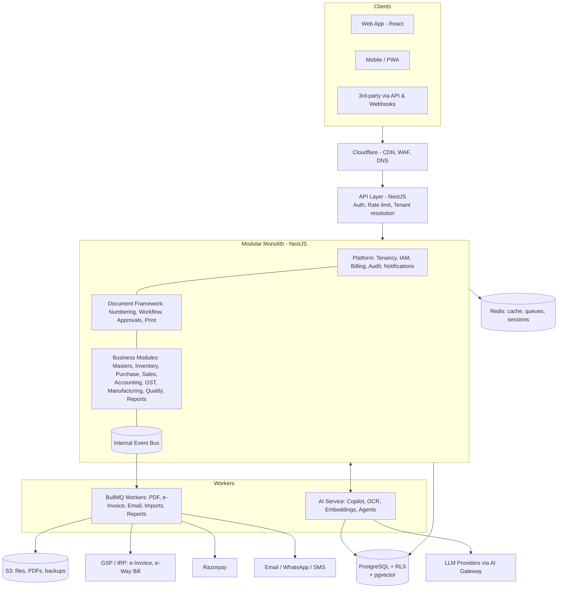
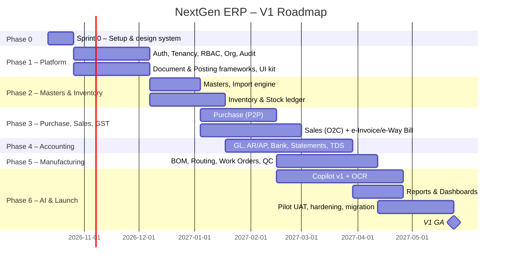

# NextGen AI ERP — Product & Delivery Plan

| | |
|---|---|
| **Product** | NextGen AI ERP: an AI-first, multi-tenant SaaS ERP for Indian MSME manufacturers |
| **Document** | Master delivery plan v1.0 |
| **Source** | `NextGenAI-ERP.docx` (requirements outline and SRS structure proposal) |
| **Date** | 5 October 2026 |
| **Status** | Draft. Needs sign-off on the decisions in §17 |
| **Detailed roadmap** | See [PHASE_PLAN.md](PHASE_PLAN.md): 16 phases, industry requirements matrix, 27-month horizon |

---

## 1. Executive Summary

NextGen AI ERP is a cloud-native ERP for small and mid-sized Indian manufacturers, both process (pharma, chemical, paint, food, cosmetics) and discrete (auto components, electronics, engineering, plastics, furniture). It sets itself apart on three things:

1. **AI-first operation.** Users can run the ERP with a copilot (text and Indic voice), OCR document capture and autonomous monitoring agents.
2. **India-native compliance.** GST, e-invoice, e-way bill, TDS, PF/ESI/PT and the DPDP Act are built in, not added on later.
3. **Manufacturing depth at MSME price and simplicity.** It sits between Tally/Zoho (too shallow for manufacturing) and SAP/Oracle (too expensive and complex).

**Delivery strategy:** we build a **modular monolith** on a strong shared platform layer. We ship a sellable **V1 in about 9 months** (Platform + Masters + Inventory + Purchase + Sales + GST + Accounting + core Manufacturing + AI Copilot v1). After that, the product grows in quarterly releases (HRMS, CRM, QMS, Maintenance, Process Manufacturing, AI Agents, Industry 4.0).

---

## 2. Assessment of the Source Document

### What is strong
- The module coverage is complete: Platform, Masters, Manufacturing (process and discrete), Finance, HRMS, CRM, WMS, AI, Industry 4.0, Reports.
- The positioning is correct (AI-first, MSME, India compliance).
- Splitting process and discrete manufacturing is the right call. Their data models really do differ.

### What we change, and why

| Source proposal | Problem | Plan decision |
|---|---|---|
| Write a 1,500–2,000 page SRS (4–7 volumes) before building | Waterfall. It would take 6–9 months, go stale quickly, and get no market feedback | **Living spec per module**, written one sprint ahead of development (§13). The same volumes still exist, but they are filled in progressively |
| "300–400 tables, 1,500+ APIs, 600–800 screens" stated as targets | These are outcomes of the work, not goals. Chasing counts produces bloat | Scope by **business process** (Procure-to-Pay, Order-to-Cash, Plan-to-Produce, Record-to-Report) |
| Microservices from day one | Huge operational cost for a small team. ERP data is highly relational, and distributed transactions across Sales/Inventory/Accounting are painful | **Modular monolith** with strict module boundaries and an internal event bus. Extract services only where scaling demands it (AI, IoT ingestion, reporting) |
| OpenAI as the fixed AI provider | Vendor lock-in, plus cost and data-residency risk | **Provider-agnostic AI gateway** (§9) |
| Elasticsearch, Kubernetes in V1 | Premature infrastructure | PostgreSQL full-text search plus managed containers first. Add ES and K8s when load justifies them |
| All modules treated as equal priority | No MVP is defined | Phased roadmap with a clear V1 scope (§3) |

### Gaps the source document does not cover (added in this plan)
- A **generic document framework** (numbering series, status machine, approvals, attachments, print templates). This is the biggest productivity lever in ERP development.
- The **stock ledger and valuation method** (FIFO / weighted average), and the **accounting posting engine** (how every transaction creates GL entries).
- **Data migration** from Tally/Excel. This is critical for MSME adoption.
- **Offline and low-bandwidth behaviour** for shop-floor and warehouse users.
- **Customisation model** (custom fields, custom print formats, workflow configuration) that does not need code forks.
- Test strategy, environments, SLAs and support model.

---

## 3. Scope & Release Strategy

### 3.1 Release map

| Release | Target | Scope |
|---|---|---|
| **V1 – Core ERP (GA)** | Month 9 | SaaS platform, Org & Masters, Inventory, Purchase, Sales, GST + e-Invoice + e-Way Bill, Accounting, Discrete Mfg core (BOM, Work Orders, Production), basic QC, Reports & Dashboards, AI Copilot v1, AI OCR (purchase invoice) |
| **V1.5** | Month 12 | Process Manufacturing (Recipe, Batch, Yield, Potency, Expiry), MRP & Capacity Planning, full QMS (IQC/IPQC/FQC, NCR, CAPA), Maintenance (breakdown, preventive, calibration), WhatsApp integration |
| **V2** | Month 15–18 | HRMS & Payroll (PF/ESI/PT/TDS), CRM (Leads → Contracts → Support/SLA), Advanced WMS (bins, put-away, pick path, RFID), AI Agents, Vendor/Customer portals, Mobile apps |
| **V3 – Enterprise** | Month 18–24 | Industry 4.0 (OPC UA, MQTT/Sparkplug B, OEE, energy, predictive maintenance), MES/SCADA connectors, Digital Twin, multi-company consolidation, White-label & partner program, Project Accounting, DMS with digital signature |

### 3.2 V1 module scope (detailed)

| Module | In V1 | Deferred |
|---|---|---|
| **Platform** | Tenant signup/provisioning, plans & feature flags, Razorpay subscriptions, users, RBAC, approval matrix, audit log, notifications (email/in-app), API keys, webhooks, data import (Excel/Tally) | White label, domain mapping, tenant migration, SMS |
| **Auth** | Email/mobile + password, OTP, MFA (TOTP), sessions, device list, IP allow-list | SSO (SAML/OIDC) → V2 |
| **Org Masters** | Company, Branch, Plant, Department, Warehouse, Cost Center, Financial Year | Multi-company consolidation |
| **Masters** | Item (general, inventory, purchase, sales, GST, batch/serial, barcode, alt UoM, images, attachments), UoM, Customer, Vendor, Tax, Currency, Bank, Payment Terms, Price Lists | Quality parameters → V1.5 |
| **Inventory** | Stock ledger, valuation (FIFO/Weighted Avg), stock transfer, adjustments, batch & serial tracking, expiry, reorder levels, barcode/QR labels | Bins/zones/pick-path → V2 |
| **Purchase** | PR → RFQ → Vendor Comparison → PO → GRN → Purchase Invoice → Debit Note, approvals | Vendor portal → V2 |
| **Sales** | Quotation → Sales Order → Delivery/Dispatch → Invoice → Returns → Credit Note | CRM pipeline → V2 |
| **GST & Compliance** | GSTIN validation, HSN/SAC, CGST/SGST/IGST/Cess, RCM, e-Invoice (IRN/QR via GSP), e-Way Bill, GSTR-1 / 3B data export, TDS/TCS on purchases | Direct GSTN filing → V1.5 |
| **Accounting** | Chart of Accounts, vouchers (journal, payment, receipt, contra), AR/AP with ageing, bank accounts, bank reconciliation (statement import), cost centers, Trial Balance, P&L, Balance Sheet, Cash Flow, multi-currency | Budgeting, fixed assets & depreciation → V1.5; consolidation → V3 |
| **Manufacturing (Discrete)** | Multi-level BOM with versions, Routing, Work Centers, Work Orders, material issue/backflush, production entry, scrap, job cards, standard costing | MRP, capacity planning, ECN → V1.5 |
| **Quality** | Incoming QC on GRN, final QC on production (pass/fail/hold) | Full QMS → V1.5 |
| **Reports** | ~40 standard reports, role dashboards (Owner, Sales, Purchase, Store, Production, Finance), export to Excel/PDF | Custom report builder → V1.5 |
| **AI** | Copilot v1 (NL queries over data, navigation, draft documents for user confirmation), OCR for purchase invoices, English + Hindi | Voice, more Indic languages, Agents → V1.5/V2 |

---

## 4. Solution Architecture



### 4.1 Key architecture decisions (ADRs)

| # | Decision | Rationale |
|---|---|---|
| ADR-01 | **Modular monolith** (NestJS modules), not microservices | Small team, transactional consistency across modules, fast iteration. Each module owns its tables and exposes services/events only |
| ADR-02 | **Shared database, shared schema, `tenant_id` + PostgreSQL Row-Level Security** | Cheapest to run for thousands of small tenants. RLS gives defense-in-depth. A dedicated-DB option is kept for enterprise tenants |
| ADR-03 | **UUID v7** primary keys | Globally unique (safe for imports, merges, offline), time-ordered so B-tree indexes stay efficient |
| ADR-04 | **Immutable ledgers** for stock and GL | Corrections happen through reversal entries, never updates. Gives auditability and simple valuation/reporting |
| ADR-05 | **Generic document framework** shared by every transaction | Write numbering, status, approvals, attachments, audit and print once, then reuse them in 60+ document types |
| ADR-06 | **Contract-first APIs** (OpenAPI generated from DTOs + shared Zod schemas) | One source of truth for validation on frontend and backend, plus auto-generated SDK and docs |
| ADR-07 | **Provider-agnostic AI gateway** | Swap or mix LLM vendors by task, cost and data residency. Usage is metered per tenant |
| ADR-08 | **AI never writes directly.** It proposes drafts or actions and a user confirms | Trust, auditability and RBAC enforcement. The AI acts with the user's permissions only |
| ADR-09 | **India data residency** (AWS ap-south-1 Mumbai) | DPDP Act readiness and customer trust |

---

## 5. Technology Stack

| Layer | Choice | Notes |
|---|---|---|
| Language | **TypeScript** everywhere | Shared types between frontend and backend |
| Monorepo | **pnpm + Turborepo** | `apps/*`, `packages/*` |
| Frontend | **Next.js 16 (App Router) + React 19** (ADR-010), TanStack Query, TanStack Table (virtualised grids), React Hook Form + Zod, Tailwind CSS + shadcn/ui, Recharts/ECharts, i18next | Keyboard-first ERP UX, dark mode, Indic i18n |
| Backend | **NestJS** (Fastify adapter), class-validator / Zod, Swagger | CQRS only where it pays off (reporting, ledgers) |
| ORM / DB access | **Drizzle ORM** + SQL migrations | Plays well with RLS (`SET LOCAL app.tenant_id` per transaction) and keeps SQL transparent for reporting |
| Database | **PostgreSQL 16+** (+ pgvector, pg_trgm) | Managed: AWS RDS/Aurora |
| Cache / Queue | **Redis + BullMQ** | Jobs: PDFs, e-invoice, emails, imports, scheduled reports |
| Realtime | **Socket.IO** (Redis adapter) | Notifications, live dashboards, copilot streaming |
| Files | **S3** (+ pre-signed URLs) | Attachments, generated PDFs, backups |
| Search | PostgreSQL FTS + trigram → **OpenSearch** when needed | Global search across documents/masters |
| PDF / Print | Handlebars HTML templates → headless Chromium (Playwright) | Tenant-customisable print formats |
| AI | AI Gateway → Claude (default: `claude-sonnet-5-5` for copilot/agents, `claude-haiku-4-5` for classification/extraction), OpenAI pluggable; pgvector for RAG | Tool-calling over our own API |
| Payments | **Razorpay** (subscriptions) | Stripe optional for exports |
| Compliance APIs | GSP partner for e-Invoice / e-Way Bill / GSTIN lookup | Shortlist: ClearTax, Masters India, IRIS, Cygnet |
| Infra | Docker, **AWS ECS Fargate** (V1) → EKS (V2+), Terraform, Cloudflare | Kubernetes only when scale needs it |
| Observability | OpenTelemetry, Prometheus + Grafana, Loki (logs), Sentry (errors) | |
| CI/CD | GitHub Actions: lint → test → build → migrate → deploy (blue/green), auto-rollback on health check failure | |
| Testing | Vitest, Supertest, Playwright (E2E), Testcontainers (Postgres) | |

---

## 6. Multi-Tenancy, Security & Compliance

### 6.1 Tenancy model
- **Hierarchy:** `Tenant (subscription)` → `Company (legal entity / GSTIN)` → `Branch / Plant` → `Warehouse / Work Center`.
- Every business table carries `tenant_id` (NOT NULL) and, where relevant, `company_id`.
- **RLS policy** on every tenant table: `tenant_id = current_setting('app.tenant_id')::uuid`. The app sets it per transaction from the JWT. The app DB role is not the table owner, so policies cannot be bypassed.
- Tenant resolution: subdomain (`acme.nextgenerp.in`) or custom domain (V3).
- Per-tenant limits: users, companies, storage, API calls, AI tokens. Enforced with Redis counters.

### 6.2 Standard columns (every business table)
`id (uuid v7)`, `tenant_id`, `company_id`, `created_at`, `created_by`, `updated_at`, `updated_by`, `deleted_at` (soft delete for masters only; transactions are cancelled, never deleted), `version` (optimistic locking).

### 6.3 Security controls

| Area | Control |
|---|---|
| Authentication | Argon2id password hashing, JWT access (15 min) + rotating refresh tokens (httpOnly cookie), TOTP MFA, OTP login, device/session management, IP allow-list |
| Authorization | RBAC (role → permission `module.resource.action`) + data scopes (company/branch/warehouse) + field-level masking for sensitive fields (salary, bank details) |
| Approvals | Configurable approval matrix (amount slabs, department, document type, multi-level) |
| Audit | Append-only audit log (who, what, when, before/after diff, IP, device), retained per policy |
| Data | TLS 1.2+, AES-256 at rest (RDS/S3 KMS), field-level encryption for PAN/Aadhaar/bank accounts |
| DPDP Act | Consent records, purpose limitation, data-principal requests (access/correction/erasure), breach-notification runbook, data retention policies |
| Backup / DR | PITR (35 days), daily snapshots, cross-region copy. RPO ≤ 15 min, RTO ≤ 4 h. Per-tenant export |
| AppSec | OWASP ASVS L2 checklist, dependency scanning, SAST in CI, annual third-party pentest. SOC 2 / ISO 27001 readiness from V2 |

---

## 7. Core Platform Frameworks (built once, used by every module)

These are what let a small team ship hundreds of screens consistently. **Build them in Phase 1, before the business modules.**

1. **Document Framework.** A base for every transaction (PO, GRN, SO, Invoice, Work Order…):
   - Numbering series per company, branch, FY and doc type (e.g., `PO/HYD/26-27/00045`)
   - Status machine: `Draft → Submitted → Approved → Completed / Cancelled` (configurable per doc type)
   - Approval workflow engine, amendments with revision history
   - Linked documents (PO → GRN → PI) with quantity tracking (ordered / received / billed)
   - Attachments, comments, activity timeline, print/email/share
2. **Posting Engine.** Turns submitted documents into **stock ledger** and **GL** entries through configurable posting rules. Cancellation produces reversal entries.
3. **Tax Engine.** GST determination (intra/inter-state, place of supply, RCM, exemptions, cess), TDS/TCS.
4. **Metadata-driven UI kit.** List view (filters, saved views, column chooser, bulk actions, export), Form view (sections, child tables, validations), and Detail view (timeline, links), all generated from a typed schema per document.
5. **Custom Fields & Print Formats.** Tenant-level additions without code changes.
6. **Notification Engine.** Event → template → channel (in-app, email, WhatsApp, SMS), with user preferences and digests.
7. **Import/Export Engine.** Excel templates with validation preview, Tally XML import, background processing.
8. **Reporting Framework.** Parameterised SQL reports with role-based access, scheduled email delivery, and dashboards built from widgets.
9. **Audit & History.** Automatic before/after capture through the ORM layer.

---

## 8. Data Model: Core Domains (V1)

| Domain | Key tables (indicative) |
|---|---|
| Platform | tenants, plans, subscriptions, invoices_saas, feature_flags, usage_counters, users, roles, permissions, user_roles, sessions, api_keys, webhooks, audit_logs, notifications |
| Organisation | companies, branches, plants, departments, warehouses, cost_centers, fiscal_years, number_series |
| Masters | items, item_variants, item_uoms, item_barcodes, item_prices, item_tax, uoms, customers, vendors, addresses, contacts, taxes, hsn_codes, currencies, exchange_rates, banks, payment_terms, price_lists |
| Inventory | stock_ledger, stock_balances (materialised), batches, serials, stock_transfers, stock_adjustments |
| Purchase | purchase_requisitions, rfqs, supplier_quotations, purchase_orders, grns, purchase_invoices, debit_notes (+ `_items` children) |
| Sales | quotations, sales_orders, delivery_notes, sales_invoices, sales_returns, credit_notes (+ `_items`), e_invoices, e_way_bills |
| Accounting | accounts (CoA), gl_entries, journal_vouchers, payments, payment_allocations, bank_statements, bank_reconciliations, tds_entries |
| Manufacturing | boms, bom_items, bom_operations, routings, work_centers, work_orders, job_cards, material_issues, production_entries, scrap_entries |
| Quality | qc_templates, qc_parameters, qc_inspections, qc_results |
| AI | ai_conversations, ai_messages, ai_actions (proposed/confirmed), ai_usage, embeddings, ocr_jobs |

V1 estimate: **~150 tables**. The full product will grow to 300+ as modules are added. The detailed ERD for each module is part of its module spec (§13).

---

## 9. AI Platform

### 9.1 Architecture
- **AI Gateway** (internal module): provider routing, prompt templates (versioned), PII redaction, token metering per tenant, response caching, fallbacks.
- **Tool layer:** the copilot calls our **own permission-checked API** as tools (`search_items`, `get_sales_summary`, `create_purchase_order_draft` …). It never queries the DB directly and never exceeds the user's permissions.
- **RAG:** pgvector embeddings for help docs, tenant SOPs and master data. Semantic search over transactions.
- **Human-in-the-loop:** every write action is a *proposal card* that the user reviews and confirms. All of it is logged in `ai_actions`.

### 9.2 Capability roadmap

| Capability | V1 | V1.5 | V2 |
|---|---|---|---|
| Copilot: Q&A over data ("today's production", "top 10 overdue customers") | ✅ | | |
| Copilot: create drafts (PO, SO, Invoice, Work Order) | ✅ | | |
| Copilot: analysis ("why did sales drop in Sept?") | basic | ✅ | |
| OCR: purchase invoices → draft PI with vendor/item matching | ✅ | | |
| OCR: delivery challans, bank statements, vendor quotations | | ✅ | |
| Demand forecasting, reorder suggestions | | ✅ | |
| Voice (English, Hindi) | | ✅ | |
| Voice (Telugu, Tamil, Marathi, Kannada) | | | ✅ |
| Autonomous Agents (Purchase, Inventory, Finance, Sales, Maintenance, Compliance, HR, Support) | | pilot (Inventory, Finance) | ✅ |
| Predictive maintenance (with IoT data) | | | V3 |

### 9.3 Agents design (V1.5+)
Agents run on schedules or events (BullMQ). They watch KPIs and rules (low stock, overdue receivables, GST mismatches, machine anomalies) and **raise recommendations** into an "AI Inbox". If the tenant enables auto-execution, they act only within tenant-defined guardrails (e.g., auto-create PR below ₹50,000).

---

## 10. India Compliance Scope

| Area | Requirement | Release |
|---|---|---|
| GST | HSN/SAC, place of supply, CGST/SGST/IGST/UTGST/Cess, RCM, composition dealers, SEZ/export (LUT) | V1 |
| e-Invoice | IRN generation, signed QR, cancellation (within 24 h), via GSP | V1 |
| e-Way Bill | Generation from invoice/delivery note, Part-B update, cancellation | V1 |
| GST Returns | GSTR-1, GSTR-3B data and JSON export; GSTR-2B reconciliation | V1 (export), V1.5 (recon + filing) |
| TDS/TCS | Sections, thresholds, lower-deduction certificates, 26Q data | V1 |
| Payroll statutory | PF, ESI, PT (state-wise), LWF, TDS on salary (Form 16), Gratuity, Bonus Act | V2 |
| DPDP Act 2023 | Consent, notices, data principal rights, retention, breach process | V1 (platform) |
| Accounting | Indian Schedule III formats, audit trail (Companies Act edit log requirement) | V1 |

---

## 11. Engineering Standards

### 11.1 Repository structure
```
nextgen-erp/
├─ apps/
│  ├─ web/                 # React app (Vite)
│  ├─ api/                 # NestJS modular monolith
│  │  └─ src/modules/{platform,iam,org,masters,inventory,purchase,sales,
│  │                   accounting,gst,manufacturing,quality,reports,ai}/
│  ├─ worker/              # BullMQ job processors
│  └─ docs/                # Product & API docs site
├─ packages/
│  ├─ ui/                  # Design system (shadcn-based components, tokens)
│  ├─ schemas/             # Shared Zod schemas & types (contract)
│  ├─ db/                  # Drizzle schema, migrations, seeds, RLS policies
│  ├─ sdk/                 # Generated API client
│  └─ config/              # ESLint, TS, Tailwind presets
├─ infra/                  # Terraform, Docker, compose for local dev
└─ docs/                   # Plan, ADRs, module specs
```

### 11.2 Module structure (backend)
Each module contains `controller → application service → domain → repository`, plus `events/`, `dto/`, `policies/` (permissions) and `tests/`. **Modules never import another module's repositories.** They talk only through exported services or events.

### 11.3 Conventions
- API: REST, `/api/v1/{module}/{resource}`, cursor pagination, filter syntax `?filter[status]=approved&sort=-date`, RFC 7807 error format, idempotency keys on create.
- Git: trunk-based development, short-lived branches, PRs with required review + green CI, Conventional Commits, semantic versioning.
- Definition of Done: spec'd, coded, unit + API tests, E2E for the happy path, permission checks, audit, i18n keys, docs updated, demo-ready.
- Quality gates: TypeScript strict, ESLint, ≥ 80% coverage on domain/posting/tax logic, zero high-severity vulnerabilities.

---

## 12. Delivery Roadmap (V1)

**Assumptions:** 2-week sprints. Core team as in §14. One pilot customer is identified by Month 5.



| Phase | Duration | Deliverables | Exit criteria |
|---|---|---|---|
| **0. Sprint 0** | 2 wks | Monorepo, CI/CD, dev/staging environments, Terraform base, design tokens & app shell, ADRs, module-spec template, Figma foundations | `main` deploys to staging automatically; hello-world tenant created via API |
| **1. Platform Foundation** | 6 wks | Signup & tenant provisioning, auth (MFA/OTP), RBAC + data scopes, org masters, number series, document framework, approvals, audit, notifications, app shell (nav, global search, command palette), List/Form UI kit | A demo document type goes Draft → Approved with audit and print, fully permission-controlled |
| **2. Masters & Inventory** | 6 wks | Item/Customer/Vendor/Tax/UoM masters, Excel/Tally import, stock ledger, valuation, transfers, adjustments, batch/serial, barcode labels | Opening stock imported; stock and valuation reports reconcile |
| **3. Purchase, Sales & GST** | 8 wks | Full P2P and O2C cycles, returns, credit/debit notes, GST engine, e-Invoice and e-Way Bill (GSP sandbox → prod), print formats | End-to-end PO → GRN → PI and SO → DN → Invoice with valid IRN in GSP sandbox |
| **4. Accounting** | 10 wks (overlaps) | CoA templates, posting rules, vouchers, AR/AP with ageing, bank recon, TDS, TB / P&L / BS / Cash Flow, GSTR-1/3B export | Books for a test month reconcile with stock and GST reports; CA review signed off |
| **5. Manufacturing core** | 8 wks | BOM (multi-level, versions), routing, work centers, work orders, material issue/backflush, production entry, scrap, job cards, IQC/FQC, standard costing | A product built from raw material to FG with correct stock and cost postings |
| **6. AI, Reports & Launch** | 10 wks (overlaps) | Copilot v1, OCR purchase invoice, 40 standard reports, role dashboards, performance tuning, security pentest, pilot data migration & UAT, help docs, onboarding wizard | Pilot runs live for 4 weeks; P1 bugs = 0; p95 API < 300 ms; pentest high findings closed |

**V1 GA: about Month 9 (July 2027).** V1.5 follows quarterly, then V2/V3 as in §3.1.

---

## 13. Documentation Approach (Living SRS)

We keep the 4-volume structure from the source document, but **fill it in progressively**:

| Volume | Content | When written |
|---|---|---|
| Vol 1 – Product & Platform | Vision, personas, pricing, SaaS architecture, security, compliance, AI platform | Sprint 0 – Phase 1 (this plan is its seed) |
| Vol 2 – Functional Specs | **One spec per module** (template below) | One sprint before that module's development |
| Vol 3 – Technical | ADRs, ERD (generated from Drizzle schema), OpenAPI (generated from code), runbooks | Continuously; generated where possible |
| Vol 4 – UI/UX | Design system in Figma + Storybook, screen specs with states | Design runs 1–2 sprints ahead of FE |
| Vol 5–7 – AI, Industry 4.0, Implementation | Specialist volumes | Before the respective release |

**Module spec template** (`docs/modules/<module>.md`):
1. Business objective & KPIs
2. Personas & roles
3. Process flow (BPMN/mermaid)
4. User stories with acceptance criteria (Given/When/Then)
5. Screen inventory (list/form/detail/report) + field tables (name, type, validation, mandatory, default, dependency)
6. Status machine & approval rules
7. Posting rules (stock / GL / tax impact)
8. Permissions matrix
9. Notifications & events
10. Reports & dashboard widgets
11. Data model (tables, relations, indexes)
12. API list
13. Edge cases, open questions

---

## 14. Team & Roles

| Role | Count (V1) | Responsibility |
|---|---|---|
| Product Owner / ERP Functional Consultant | 1 | Module specs, domain decisions, UAT, pilot customer relationship |
| Tech Lead / Architect | 1 | Architecture, platform frameworks, code review, DevOps oversight |
| Backend Engineers (NestJS) | 2–3 | Modules, posting/tax engines, integrations |
| Frontend Engineers (React) | 2 | UI kit, screens, dashboards |
| AI Engineer | 1 (from Phase 3) | AI gateway, copilot tools, OCR, evals |
| UI/UX Designer | 1 | Design system, screen designs |
| QA Engineer (automation) | 1 | Test plans, Playwright E2E, regression |
| Chartered Accountant (advisor) | part-time | Accounting, GST and TDS validation |
| DevOps | part-time / Tech Lead | Infra, monitoring, security |

With AI-assisted development (Claude Code), the backend and frontend headcount can trend toward the lower end. The domain experts (functional consultant, CA) cannot be replaced.

---

## 15. Quality, Environments & Operations

- **Environments:** `local` (Docker Compose) → `dev` (every merge) → `staging` (release candidate, anonymised data) → `production`. Plus a **GSP sandbox** for compliance tests.
- **Testing pyramid:** unit tests (domain, tax, posting) → API integration tests (Testcontainers) → E2E business flows (Playwright: P2P, O2C, Plan-to-Produce, Record-to-Report) → performance (k6) → security (OWASP ZAP + pentest).
- **Golden test datasets:** a sample manufacturer with a full year of transactions, used to regression-test financial statements and GST returns on every release.
- **SLOs:** 99.9% uptime, p95 API < 300 ms, report generation < 10 s (async beyond that).
- **Support:** in-app help, ticketing, status page, release notes per deployment.

---

## 16. Risks & Mitigations

| Risk | Impact | Mitigation |
|---|---|---|
| Scope creep (the "build everything" vision) | Very high | Strict V1 scope (§3.2); change control by the Product Owner; every new request goes to the roadmap backlog |
| Accounting/GST correctness errors | Very high (trust, legal) | CA advisor, golden datasets, immutable ledgers, reconciliation reports, GSP sandbox certification |
| Weak ERP domain knowledge in the team | High | Functional consultant from Day 1, pilot customer co-design, study of Tally/Odoo/ERPNext flows |
| Multi-tenant data leak | Critical | RLS + app-level checks + automated cross-tenant tests in CI + pentest |
| AI hallucination or wrong actions | High | Tools-only data access, confirm-before-write, evals per tool, AI usage audit |
| LLM cost overruns | Medium | Per-tenant token quotas, model routing (small models for simple tasks), caching, plan-based AI credits |
| MSME adoption friction (moving off Tally/Excel) | High | Tally import, onboarding wizard, industry templates (CoA, items, BOMs), WhatsApp-friendly flows, Hindi UI |
| GSP / government API changes | Medium | Isolated adapter layer, GSP abstraction (switch providers), monitoring of GSTN advisories |
| Performance on large tenants | Medium | Materialised balances, partitioning of ledgers by tenant/date, read replica for reports |

---

## 17. Decisions Needed Before Development Starts

| # | Decision | Recommendation |
|---|---|---|
| D1 | **Pilot industry for V1**: discrete or process manufacturing? | **Discrete first** (engineering / auto components / plastics). Simpler costing; process mfg in V1.5 |
| D2 | Team size & budget (confirms the 9-month timeline) | §14 core team |
| D3 | Pilot customer(s) identified? | At least 1 committed by Month 5 |
| D4 | GSP partner for e-Invoice / e-Way Bill | Get quotes from 2–3 (ClearTax, Masters India, IRIS) in Sprint 0 |
| D5 | Primary LLM provider & budget | Provider-agnostic gateway; start with Claude, keep OpenAI as fallback |
| D6 | Cloud & region | AWS Mumbai (ap-south-1) |
| D7 | Pricing model | Per-company base + per-user tiers + AI credits (finalise in Vol 1) |
| D8 | Product name, domain, branding | Needed for Sprint 0 design system |
| D9 | Mobile approach for V1 | Responsive PWA in V1; native (React Native) apps in V2 |

---

## 18. Sprint 0: Immediate Next Steps

Status as of 5 Oct 2026 (✅ done · 🟡 partial · ☐ to do):

1. 🟡 Decisions: going with the plan's recommendations (discrete manufacturing first, AWS Mumbai, Claude via AI gateway). Team size, pilot customers, GSP partner and branding still open
2. ✅ Git repo + npm-workspaces monorepo: `frontend/`, `backend/`, `database/` (folder names chosen by product owner)
3. 🟡 Local infra: project-local PostgreSQL 18 cluster (`npm run db:init`, port 5434), no Docker needed. Redis, MinIO and Mailpit are still to do (needed from Phase 1 for queues and files)
4. ✅ DB package: Drizzle schema (tenancy, IAM, audit), UUID v7, standard columns, RLS (`sql/rls.sql`), migrations, seed, tenant-isolation tests
5. 🟡 NestJS 12 (Fastify) skeleton: env validation, health checks, RFC 7807 errors, JWT auth + rotating refresh, RBAC guard, tenant-scoped DB access, audit service, Swagger. OpenTelemetry/structured logging still to do
6. 🟡 Next.js 16 frontend (ADR-010): API proxy, auth context with silent refresh, login/signup/workspace picker, app shell (responsive, permission-aware nav), dashboard, companies page, light/dark tokens. i18n still to do
7. 🟡 CI (GitHub Actions): migrate, seed, RLS tests, typecheck, build, lint. Deploy to dev still to do
8. ✅ ADR index in `docs/adr/README.md` (ADR-001…012)
9. ✅ Module spec #1: **Platform & IAM** ([docs/modules/platform-iam.md](modules/platform-iam.md)), including the Phase 1 sprint plan
10. 🟡 Design tokens + core components (Button, Field, Card, Alert). Figma library still to do

---

*This plan is the seed of Volume 1. It will be reviewed and re-baselined at the end of every phase.*
