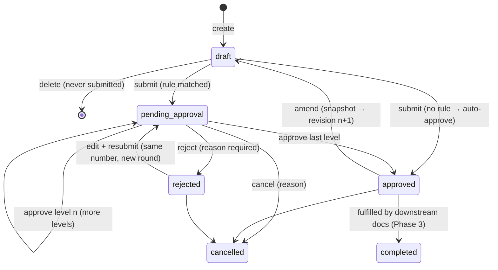

# Module spec: Document framework (Phase 1 · Sprint 1.2)

| | |
|---|---|
| **Status** | Done (5 Oct 2026) |
| **First consumer** | Purchase Requisition (`/purchase/requisitions`) |
| **Code** | `backend/src/modules/documents/`, `database/src/schema/documents.ts`, `frontend/src/components/documents/` |

Every business transaction (PR, PO, GRN, invoices, work orders…) is built on this framework, so numbering, approvals, revisions, attachments, comments, audit and print behave identically everywhere.

## 1. Data model

```
documents (shared header: number, status, revision, amount, dates, version)
  ├── purchase_requisitions (1:1, type-specific fields) ── purchase_requisition_lines
  ├── document_approvals  (steps snapshotted per submission round)
  ├── document_activity   (timeline + comments)
  ├── document_revisions  (snapshot before each amendment)
  ├── document_links      (PR → PO → GRN …)
  └── attachments         (entity_type = 'document')
number_series → number_series_counters (per period, gapless)
approval_rules → approval_rule_steps
```

## 2. Lifecycle



## 3. Rules

| Topic | Rule |
|---|---|
| **Numbering** | Assigned on **first submit**, so drafts never consume numbers. The counter upsert locks the row until commit, which makes numbers gapless and unique even under concurrent submits (tested with 5 parallel submits). Series lookup order: branch default → company default → auto-created `Default` series from `DOC_TYPES`. GST document types are validated against CGST Rule 46 (≤16 chars, `A-Z 0-9 / -`). |
| **Fiscal year** | Indian FY from the company's `fy_start_month` (default April). Counters reset per FY, per month, or never. |
| **Approvals** | First active rule matching doc type + company/branch + amount slab (lowest `priority` wins). Steps are snapshotted at submit, so later rule edits don't affect in-flight documents. Each level is approved by any holder of a role, or by a named user. **The submitter can never approve their own document.** Rejecting needs a reason and skips the remaining levels. |
| **Editing** | Allowed only in `draft` / `rejected`. Every write sends `version`; a stale version returns `409`. |
| **Amendment** | `approved` → snapshot saved to `document_revisions`, `revision + 1`, back to `draft`, re-approval required. The number is kept and displayed as `PR/HO/26-27/0007 (Rev 1)`. |
| **Cancel vs delete** | Never-submitted drafts are deleted. Anything numbered is cancelled with a reason and kept for audit. |
| **Money** | Exact decimal arithmetic (`backend/src/common/decimal.ts`, BigInt-based, half-up). Amounts travel as strings. |
| **Attachments** | 10 MB max; PDF, images, Excel, Word, CSV and text only; SHA-256 recorded; soft-deleted by uploader only; files on cancelled/completed documents are kept. Local disk in dev (`STORAGE_DIR`), S3 in deployed environments. |
| **Access** | Reading a document requires `DOC_TYPES[type].readPermission`. Acting requires the module's `manage` / `cancel` permissions. Approving requires being the eligible approver. All of this runs inside PostgreSQL RLS. |
| **Audit** | `document.created/updated/submitted/approved/rejected/cancelled/amended/deleted`, attachment add/remove → `audit_logs`; human-readable timeline → `document_activity`. |

## 4. Adding a new document type (checklist)
1. Add it to `DOC_TYPES` in `database/src/doc-types.ts` (label, code, path, default pattern, read permission, `gstDocument`).
2. Add permissions (`<module>.<resource>.read/manage/cancel`) in `database/src/permissions.ts`, then run `npm run db:seed`.
3. Create the type table with `id` → `documents.id` (1:1) plus line tables, then `npm run db:generate && npm run db:migrate`.
4. Write a service that calls `DocumentsService.create / lock / update / submit / cancel / amend / view` inside one `database.run()` transaction.
5. Frontend: list, form, detail (reuse `DocumentActions`, `ApprovalProgress`, `ActivityFeed`, `AttachmentsPanel`, `RevisionsPanel`), and a print page.
6. E2E: copy the patterns in `backend/test/e2e/documents.e2e.test.ts`.

## 5. API
| Endpoint | Purpose |
|---|---|
| `GET /documents?q&docType&status` | Search across readable types (for global search) |
| `GET /documents/approvals/inbox` | My pending approvals |
| `POST /documents/:id/approve` · `/reject` | Decide (body: `version`, `comment`) |
| `GET /documents/:id/activity` · `POST /documents/:id/comments` | Timeline, comments |
| `GET /documents/:id/revisions` | Amendment history with snapshots |
| `GET/POST /documents/:id/attachments` · `GET /documents/attachments/:id/download` · `DELETE /documents/attachments/:id` | Files |
| `GET /platform/document-types` | Registry |
| `GET/POST/PATCH /platform/number-series` · `POST /platform/number-series/preview` | Numbering admin |
| `GET/POST/PUT/DELETE /platform/approval-rules` | Workflow admin |
| `GET/POST/PUT/DELETE /purchase/requisitions[/:id]` · `POST …/:id/submit` · `/cancel` · `/amend` | Purchase Requisition |

## 6. Deferred
- **Line-level quantity tracking across links** (PO qty received/billed) arrives with Purchase/Sales in Phase 3, when there are downstream documents. `document_links` already exists.
- **Notifications to approvers** (email / WhatsApp / in-app) arrive in Sprint 1.3. Today approvers see the sidebar badge and the inbox.
- **Server-side PDF and print-format designer** arrive in Sprint 1.3. Today: browser print / Save as PDF from an A4 layout.
- **Domain events** (e.g. "PR approved" → suggest PO): an internal event bus is planned for Sprint 1.3.
